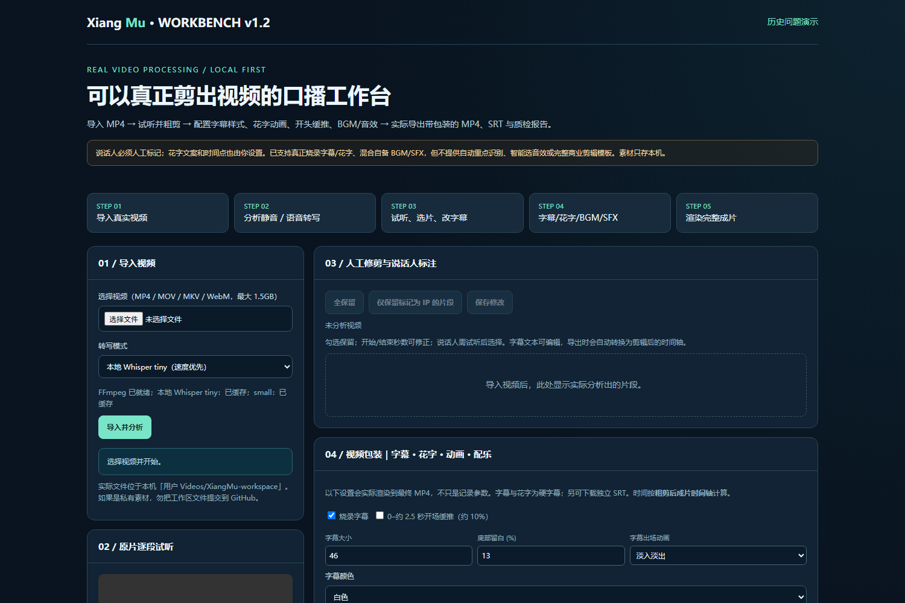

# Xiang Mu｜本地口播视频剪辑工作台

**从真实视频素材到可交付的 MP4 成片。**

Xiang Mu 是一套运行在 Windows 本机的口播视频剪辑工作台。它将视频导入、静音分析、片段复核、字幕编辑、画面包装和成片导出整合在一个操作界面中。

- [在线项目首页](https://z15314102792-arch.github.io/Xiang-Mu/)
- [实际操作演示](https://z15314102792-arch.github.io/Xiang-Mu/walkthrough.html)
- [GitHub 源码](https://github.com/z15314102792-arch/Xiang-Mu)
- [MP4 渲染样例](https://github.com/z15314102792-arch/Xiang-Mu/blob/gh-pages/assets/render-demo.mp4)



## 核心功能

| 模块 | 功能 |
|---|---|
| 视频导入 | 支持 MP4、MOV、MKV、WebM，单文件最大 1.5GB |
| 视频分析 | 使用 FFprobe 读取媒体信息，FFmpeg 检测静音区间并生成候选片段 |
| 片段编辑 | 逐段试听、调整起止时间、拆分片段、选择保留范围 |
| 说话人标注 | 为片段标记 IP、操盘手或其他类别 |
| 语音转写 | 可选本地 Whisper tiny/small 模型，转写文本可人工编辑 |
| 字幕 | 编辑字幕文本、字号、颜色、位置和入场动画；导出独立 SRT |
| 重点花字 | 添加文案，设置剪后时间轴、位置、颜色和入场动画 |
| 画面动画 | 可选开头约 2.5 秒、10% 的中心缓推 |
| 音频包装 | 上传 BGM 并设置循环、淡入淡出和音量；上传音效并设置触发时间 |
| 成片导出 | 使用 FFmpeg / libass 渲染 H.264/AAC MP4，并生成 SRT 和 JSON 质检报告 |

## 工作流程

```text
导入视频
   ↓
读取媒体信息、分析静音区间
   ↓
逐段试听与人工复核
   ↓
调整片段、标记说话人、编辑字幕
   ↓
配置花字、开场动画、BGM 与音效
   ↓
FFmpeg 渲染
   ↓
预览并下载 MP4、SRT、JSON 报告
```

所有片段起止时间、说话人和字幕均可在工作台中调整。字幕、花字和音频包装参数会进入实际渲染流程，最终写入导出视频。

## 快速开始（Windows）

### 环境要求

- Python 3.10+
- FFmpeg 与 FFprobe，并启用 libass 字幕滤镜
- 可选：openai-whisper 与已缓存的 tiny 或 small 模型

### 启动

在仓库根目录双击：

`start-demo.bat`

也可以在终端运行：

```powershell
python media_server.py --open
```

工作台地址：

`http://127.0.0.1:8990/`

### 素材与导出位置

真实视频、音频、草稿和导出文件默认保存在：

`~/Videos/XiangMu-workspace`

可通过环境变量 `XIANG_MU_WORKSPACE` 指定其他工作目录。素材和成片保存在本机工作区，不进入 GitHub 仓库。

## 技术实现

| 层级 | 技术 | 用途 |
|---|---|---|
| 本地服务 | Python 标准库 HTTP Server | 上传、任务状态、包装配置、预览和下载 |
| 媒体分析 | FFprobe、FFmpeg silencedetect | 读取媒体信息、分析静音区间 |
| 语音转写 | Whisper（可选） | 本地语音转文字 |
| 视频剪辑 | FFmpeg | 按确认的片段区间裁剪和合并 |
| 字幕与花字 | ASS / libass | 字幕、重点花字和入场动画渲染 |
| 音频处理 | FFmpeg audio filters | BGM 循环、淡入淡出和音效混音 |
| 前端界面 | HTML、CSS、JavaScript | 本地剪辑与包装操作台 |

## 输出文件

每次导出可获得：

- **MP4**：完成片段剪辑、字幕、花字动画和音频包装的成片。
- **SRT**：映射到剪辑后时间轴的独立字幕文件。
- **JSON 报告**：记录本次媒体处理与包装结果。

## 历史规则质检演示

仓库保留了早期的口播剪辑质量规则演示，可通过本地服务访问：

`http://127.0.0.1:8990/demo`

该模块包含 8 条规则和 9 个案例，用于展示对粗剪、字幕、花字和音效问题的结构化检查。它与真实媒体工作台分开运行。

## 项目结构

```text
Xiang-Mu/
├── start-demo.bat
├── media_server.py
├── media_workflow.py
├── package_render.py
├── portfolio.py
├── data/
│   ├── cases.json
│   ├── lock.json
│   └── rules.json
├── web/
│   ├── workbench.html
│   ├── packaging.js
│   └── index.html
├── tests/
│   ├── test_media_http.py
│   ├── test_media_real.py
│   ├── test_packaging_real.py
│   └── test_portfolio.py
├── tools/
│   └── release_audit.py
└── docs/
    └── PROJECT_STORY.md
```

## 自动化测试

在仓库根目录运行：

```powershell
python -m unittest discover -s tests -v
python portfolio.py demo
python tools/release_audit.py
```

当前测试集共 18 项，覆盖媒体分析、片段编辑校验、SRT 时间轴映射、HTTP 上传与导出、字幕花字渲染、BGM/SFX 混音及历史规则演示。

## 关联项目

- [n8n AI Agent 与知识库自动化系统](https://github.com/z15314102792-arch/n8n-ai-agent) — 独立的 n8n Agent、RAG 知识库、长期记忆与项目进度自动化项目。

## 项目设计与迭代

项目问题拆解、剪辑流程设计、质量标准和功能验收记录见 [项目设计与迭代](./docs/PROJECT_STORY.md)。
