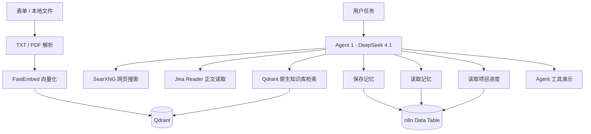

# 基于 n8n 的个人 AI Agent 与知识库自动化系统

基于 n8n 构建可调用工具的个人 AI Agent，将网页研究、知识库检索、文档入库、长期记忆和项目进度查询连接为一套自动化工作系统。

Agent 使用 DeepSeek 4.1 作为推理模型，通过 SearXNG 搜索网页、Jina Reader 读取正文、Qdrant 检索个人知识库，并调用独立工作流完成记忆读写和项目查询。

## 核心能力

| 模块 | 实现内容 |
|---|---|
| 网页研究 | SearXNG 动态搜索 + Jina Reader 正文读取 |
| 知识库问答 | Agent 原生 Qdrant Vector Store，语义检索个人资料 |
| 文档入库 | 表单上传与本地文件双入口，支持 TXT/PDF 解析、文本切片、Embedding 和 Qdrant 写入 |
| 长期记忆 | n8n Data Table 保存、更新和读取结构化记忆 |
| 项目进度 | 按项目名称查询进度记录，返回内容、证据、标签和更新时间 |
| 工作流工具 | Agent 调用独立 n8n 子工作流并接收结构化结果 |
| 任务协作 | Skills 指导任务拆分与子 Agent 协作，并设置搜索、阅读和委派资源上限 |

## 系统架构



## 技术栈

| 类别 | 技术 |
|---|---|
| 工作流编排 | n8n 2.46.7（Docker 自托管） |
| Agent 模型 | DeepSeek 4.1 |
| 网页搜索 / 正文读取 | SearXNG / Jina Reader |
| 向量数据库 | Qdrant 1.20.0 |
| Embedding 服务 | FastEmbed 0.9.1 |
| Embedding 模型 | `BAAI/bge-small-zh-v1.5` |
| 向量配置 | 512 维、Cosine（余弦相似度） |
| 结构化记忆 | n8n Data Table |
| 自动化代码 | JavaScript |
| 部署环境 | Windows + Docker |

## Agent 工具与 Skills

Agent 1 在 n8n Agent Builder 中配置：

- `web_search`：SearXNG 网页搜索。
- `web_reader`：Jina Reader 网页正文读取。
- `知识库入口`：Qdrant 原生语义检索。
- `save-memory`：保存或更新记忆。
- `read-memory`：读取历史记忆。
- `读取项目进度`：查询项目进度与证据。
- `add-numbers`：算术计算工作流。

Agent Skills：

- **网页资料研究与事实核验**：搜索、读取原文、交叉核验来源并整理证据。
- **复杂任务编排与多智能体协作**：拆分独立任务、协调子 Agent 并整合结果。

复杂任务设置资源上限：每个任务最多委派 2 个子 Agent、最多同时运行 1 个；搜索和正文读取设置全局调用上限；遇到余额不足或 HTTP 402 时停止后续调用。

## 工作流清单

六条核心工作流 JSON 位于 [workflows](./workflows/) 目录。

| 工作流 | 节点数 | 主要职责 |
|---|---:|---|
| [知识库入库](./workflows/knowledge-base-ingest.json) | 8 | 表单与子工作流双入口，文档解析、向量化并写入 Qdrant |
| [本地文件读取与入库](./workflows/local-file-ingest.json) | 9 | 读取文件目录，按 TXT/PDF 分流解析并调用入库子工作流 |
| [保存记忆](./workflows/save-memory.json) | 2 | 根据记忆键执行 Upsert，保存或更新记录 |
| [读取记忆](./workflows/read-memory.json) | 2 | 按用户范围、Agent 和状态读取结构化记忆 |
| [读取项目进度](./workflows/read-project-progress.json) | 5 | 标准化查询条件，筛选项目记录并返回证据 |
| [Agent 工具演示](./workflows/agent-tool-demo.json) | 2 | 接收两个数字，执行计算并返回结构化结果 |

## 实际运行结果

### 网页搜索与正文读取
Agent 动态生成搜索词并调用 SearXNG，历史多轮搜索返回约 42–45 条结果；随后将 URL 传给 Jina Reader，正文读取请求返回 HTTP 200，正文约 3,899 字节。

### 文档入库与语义检索
一份 99 行 TXT 文档解析后生成 2 个文本块。FastEmbed 生成 512 维向量，Qdrant 将正文和 metadata 写入 `agent_knowledge_prod`。两个 Point 均可逐条读回，语义查询得分约为 0.6816 和 0.5661。

正式知识库入口「知识库入口」与别名 `agent_knowledge_native` 均指向 `agent_knowledge_prod`。

### 项目进度查询
以 `project_name=n8n` 查询时，工作流扫描 3 条活动记忆，匹配 1 条项目记录，并返回正文、证据、重要程度、标签和更新时间；不存在的项目名称返回 0 条匹配记录。

### 记忆读写与工具调用
「保存记忆」通过 Data Table Upsert 新增或更新记录；「读取记忆」按条件读回结构化记录。Agent Preview 执行记录中包含记忆和项目进度工具调用。

## 导入与使用

1. 在 n8n 中选择 **Workflows → Import from File（从文件导入）**。
2. 按 [工作流导入指南](./docs/IMPORT.md) 的顺序导入六条工作流。
3. 配置 Qdrant、FastEmbed 和 Data Table。
4. 在记忆相关工作流中设置一致的 `YOUR_SCOPE_ID` 和 `YOUR_AGENT_ID`。
5. 在 Agent Builder 中关联搜索、正文读取、知识库和工作流工具。

本仓库集中保存六条核心工具工作流及项目文档。Agent 模型、系统指令、Skills 和外部服务凭据在 n8n Agent Builder 与 Credentials 中配置。

## 项目文档

- [系统架构](./docs/ARCHITECTURE.md)
- [工作流导入指南](./docs/IMPORT.md)
- [运行结果](./docs/RESULTS.md)
- [简历项目描述](./docs/RESUME.md)

## 项目目录

```text
n8n-ai-agent/
├── README.md
├── docs/
│   ├── ARCHITECTURE.md
│   ├── IMPORT.md
│   ├── RESULTS.md
│   └── RESUME.md
└── workflows/
    ├── agent-tool-demo.json
    ├── knowledge-base-ingest.json
    ├── local-file-ingest.json
    ├── read-memory.json
    ├── read-project-progress.json
    └── save-memory.json
```

## 项目实践

负责场景拆解、Agent 工具规划、n8n 工作流设计与配置、模型及外部服务接入、知识库结构设计、异常排查和运行验收。工作流中的 JavaScript 节点与自动化逻辑结合 AI 辅助开发完成。
