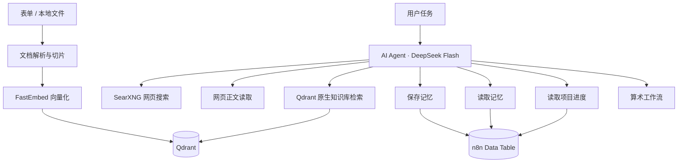

# 个人 AI Agent 与知识库自动化系统

> 基于 n8n 构建的个人智能工作台：让 AI 能够搜索网页、读取资料、检索知识库、调用工作流，并维护项目记忆。

**在线展示：** [AI Agent 项目展示页](https://z15314102792-arch.github.io/Xiang-Mu/n8n-agent/)  
**源码目录：** [projects/n8n-agent](https://github.com/z15314102792-arch/Xiang-Mu/tree/main/projects/n8n-agent)

## 项目概览

以 n8n 为流程编排中心，使用 DeepSeek Flash 作为 Agent 模型，连接 SearXNG 网页搜索、网页正文读取、Qdrant 向量知识库和 n8n Data Table 记忆系统。Agent 根据任务选择工具，将搜索、阅读、知识检索、记忆读写和项目进度查询组合成连续执行流程。

核心设计是把模型推理与外部能力拆开：模型负责理解目标和选择动作，n8n 工作流负责执行具体任务，Qdrant 负责语义检索，Data Table 负责结构化记忆。

## 核心能力

| 能力 | 实现方式 |
|---|---|
| 网页研究 | SearXNG 搜索 + 网页正文读取，支持搜索结果继续进入正文阅读 |
| 知识库问答 | Agent 原生 Qdrant Vector Store，基于语义相似度检索资料 |
| 文档入库 | 表单上传或工作流调用，解析 TXT/PDF、文本切片、向量化并写入 Qdrant |
| 长期记忆 | n8n Data Table 保存与读取，使用 Upsert 更新已有记忆 |
| 项目进度 | 按项目名称筛选活动记忆，返回正文、证据和更新时间 |
| 工作流工具 | Agent 调用独立 n8n 子工作流，传入结构化参数并接收结果 |

## 系统架构



## 关键技术配置

- **流程编排：** n8n 2.46.7，Docker 自托管。
- **Agent 模型：** DeepSeek Flash。
- **搜索服务：** SearXNG，通过 HTTP Request Tool 接入。
- **向量数据库：** Qdrant 1.20.0，正式集合 `agent_knowledge_prod`。
- **Embedding：** FastEmbed 0.9.1，`BAAI/bge-small-zh-v1.5`，512 维向量。
- **相似度计算：** Cosine（余弦相似度）。
- **记忆存储：** n8n Data Table，表名「agent记忆」。
- **Agent Skills：** 网页资料研究与事实核验、复杂任务编排与多智能体协作。

## 工作流清单

| 工作流 | 节点数 | 作用 |
|---|---:|---|
| 知识库入库 | 8 | 表单与子工作流双入口，文档加载、向量化、写入 Qdrant |
| 本地文件读取 | 10 | 读取待处理目录，按 TXT/PDF 分流解析并调用入库工作流 |
| 保存记忆 | 2 | 按稳定记忆键执行 Upsert |
| 读取记忆 | 2 | 从记忆表读取结构化记录 |
| 读取项目进度 | 5 | 标准化查询条件、筛选项目记录并返回证据 |
| Agent 工具演示 | 2 | 接收两个数字并返回结构化计算结果 |

工作流 JSON 位于 [workflows](./workflows/)；架构细节见 [ARCHITECTURE.md](./docs/ARCHITECTURE.md)，执行案例见 [RESULTS.md](./docs/RESULTS.md)，导入步骤见 [IMPORT.md](./docs/IMPORT.md)。

## 实际运行案例

### 1. 搜索与网页阅读连续调用
Agent 根据问题生成搜索词，调用 SearXNG 获取结果，再提取 URL 交给网页读取工具，读取正文后整合回答。历史测试中搜索响应可返回约 42–45 条结果，网页正文读取返回 HTTP 200。

### 2. 文档入库与语义检索
将《检查Agent配置.txt》作为正式资料入库。99 行文本经解析后生成 2 个文本块，写入 512 维 Qdrant 集合；逐条读回正文和 metadata，随后通过语义查询命中对应内容。

### 3. Agent 原生知识库检索
Agent Preview 实际调用原生 Qdrant 检索工具，通过「知识库入口」访问正式集合，返回相关文本块，并依据资料回答项目代号、负责人、归档周期和数据保留期限等字段。

### 4. 项目进度查询
Agent 调用「读取项目进度」工作流，扫描活动记忆记录，按项目名称匹配并返回项目正文、证据和更新时间；不存在的项目名称返回空结果。

## 项目实践

围绕个人知识管理场景，将 AI Agent 拆解为可组合的能力模块：

1. 设计 Agent 与工具之间的输入输出结构，让模型可以按任务调用工作流。
2. 搭建本地向量化服务与 Qdrant，完成文档入库、元数据保存和语义检索。
3. 将长期记忆与项目进度放入结构化数据表，支持按键更新和条件读取。
4. 为搜索、HTTP 错误、空结果、Embedding 维度和知识库集合别名等问题建立排查与验证流程。
5. 使用 Agent Skills 管理研究流程和复杂任务编排规则。

## 项目目录

```text
projects/n8n-agent/
├── README.md
├── docs/
│   ├── ARCHITECTURE.md
│   ├── IMPORT.md
│   ├── RESULTS.md
│   └── RESUME.md
└── workflows/
    ├── agent-tool-demo.json
    ├── knowledge-base-ingest.json
    ├── local-file-ingest.json
    ├── read-memory.json
    ├── read-project-progress.json
    └── save-memory.json
```

## 项目角色

负责场景拆解、Agent 工具规划、n8n 工作流设计与配置、模型和外部服务接入、知识库结构设计、异常排查及运行验收。工作流中的 JavaScript 节点与自动化逻辑结合 AI 辅助开发完成。
