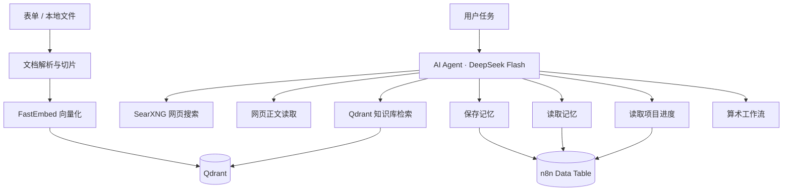

# 基于 n8n 的个人 AI Agent 与知识库自动化系统

基于 n8n 构建个人 AI Agent，将 DeepSeek Flash、SearXNG 网页搜索、网页正文读取、Qdrant 向量知识库和结构化记忆连接起来。Agent 根据任务调用不同工具，完成资料搜索、知识检索、记忆读写和项目进度查询。

## 项目目标

把 AI 从单轮问答扩展为可以调用外部工具的任务执行流程：

- 需要外部资料时，搜索网页并读取正文。
- 需要内部资料时，从个人知识库检索相关内容。
- 需要保存信息时，将内容写入结构化记忆。
- 需要回顾项目时，按项目名称查询进度和证据。
- 需要处理文档时，解析文件、切分文本、生成向量并写入知识库。

## 核心功能

| 模块 | 实现内容 |
|---|---|
| 网页研究 | SearXNG 搜索，提取结果 URL 并调用网页读取工具获取正文 |
| 知识库问答 | Agent 通过 Qdrant 原生 Vector Store 入口进行语义检索 |
| 文档入库 | 表单上传或工作流调用，解析 TXT/PDF、文本切片、Embedding 向量化并写入 Qdrant |
| 长期记忆 | n8n Data Table 保存和读取结构化记忆，使用 Upsert 更新已有记录 |
| 项目进度 | 按项目名称筛选记忆记录，返回项目内容、证据、标签和更新时间 |
| 工作流工具 | Agent 将结构化参数传入独立 n8n 工作流，并接收执行结果 |

## 系统架构



### 主要数据流

**文档入库：**

`表单 / 文件目录 → 文档解析 → 文本切片 → FastEmbed → Qdrant`

**网页研究：**

`用户问题 → SearXNG 搜索 → 提取 URL → 网页正文读取 → 信息整理`

**记忆管理：**

`Agent → 保存 / 读取记忆工作流 → n8n Data Table`

**项目查询：**

`Agent → 读取项目进度 → 筛选项目记录 → 返回进度与证据`

## 技术栈

| 类别 | 技术 |
|---|---|
| 工作流编排 | n8n 2.46.7 |
| Agent 模型 | DeepSeek Flash |
| 网页搜索 | SearXNG |
| 网页正文读取 | HTTP 网页读取工具 |
| 向量数据库 | Qdrant 1.20.0 |
| Embedding 服务 | FastEmbed 0.9.1 |
| Embedding 模型 | `BAAI/bge-small-zh-v1.5` |
| 向量配置 | 512 维，Cosine（余弦相似度） |
| 结构化记忆 | n8n Data Table |
| 自动化代码 | JavaScript |
| 部署环境 | Docker |

## 工作流清单

工作流 JSON 保存在 [workflows](./workflows/) 目录。

| 工作流 | 节点数 | 主要职责 |
|---|---:|---|
| [知识库入库](./workflows/knowledge-base-ingest.json) | 8 | 表单与子工作流双入口，解析文档并写入 Qdrant |
| [本地文件读取](./workflows/local-file-ingest.json) | 10 | 读取文件目录，按 TXT/PDF 分流，提取正文并调用入库流程 |
| [保存记忆](./workflows/save-memory.json) | 2 | 按记忆键执行 Upsert，保存或更新记录 |
| [读取记忆](./workflows/read-memory.json) | 2 | 根据输入条件读取结构化记忆 |
| [读取项目进度](./workflows/read-project-progress.json) | 5 | 标准化查询条件，筛选项目记录并返回证据 |
| [Agent 工具演示](./workflows/agent-tool-demo.json) | 2 | 接收两个数字，执行计算并返回结构化结果 |

## 运行示例

### 1. 网页搜索与正文读取

Agent 根据用户问题生成搜索词，调用 SearXNG 获取结果，再将结果 URL 交给网页读取工具。多轮搜索返回约 42–45 条结果，网页读取请求返回 HTTP 200 正文，Agent 根据正文整理信息。

### 2. 文档入库与语义检索

将一份 99 行 TXT 文档提交至知识库入库流程：

1. 文档解析后生成 2 个文本块。
2. FastEmbed 生成 512 维向量。
3. Qdrant 将向量、正文和 metadata 写入 `agent_knowledge_prod` 集合。
4. 逐条读回正文和元数据。
5. 使用语义查询检索到相关文本块。

### 3. Agent 原生知识库检索

Agent 通过 Qdrant 原生知识库工具检索资料，单次检索返回 4 条相关结果，并根据检索内容回答文档中的结构化字段。

### 4. 项目进度查询

调用「读取项目进度」工作流，以 `project_name=n8n` 查询项目记录。流程读取活动记忆、筛选项目类型记录，并返回项目正文、证据、重要程度、标签和更新时间；本次查询扫描 3 条活动记录，匹配到 1 条项目记录。

### 5. 记忆保存与读取

「保存记忆」工作流通过 Data Table Upsert 写入或更新记录；「读取记忆」工作流按查询条件返回对应记录。Agent 可将两条工作流作为工具调用。

## Agent 工具与技能

Agent 已配置以下工具：

- `web_search`：SearXNG 网页搜索。
- `web_reader`：网页正文读取。
- `知识库入口`：Qdrant 原生语义检索。
- `save-memory`：保存或更新记忆。
- `read-memory`：读取记忆。
- `读取项目进度`：查询项目进度与证据。
- `add-numbers`：算术工作流。

Agent Skills：

- 网页资料研究与事实核验。
- 复杂任务编排与多智能体协作。

## 导入与使用

1. 在 n8n 中选择 **Workflows → Import from File**。
2. 按 [工作流导入指南](./docs/IMPORT.md) 的顺序导入 JSON。
3. 配置 Qdrant、FastEmbed、SearXNG 和 Data Table 连接。
4. 在 Agent Builder 中关联工作流工具并配置输入字段。
5. 根据实际文件目录设置本地文件读取工作流。

## 项目文档

- [系统架构](./docs/ARCHITECTURE.md)
- [运行结果](./docs/RESULTS.md)
- [工作流导入指南](./docs/IMPORT.md)
- [简历项目描述](./docs/RESUME.md)

## 项目目录

```text
projects/n8n-agent/
├── README.md
├── docs/
│   ├── ARCHITECTURE.md
│   ├── IMPORT.md
│   ├── RESULTS.md
│   └── RESUME.md
└── workflows/
    ├── agent-tool-demo.json
    ├── knowledge-base-ingest.json
    ├── local-file-ingest.json
    ├── read-memory.json
    ├── read-project-progress.json
    └── save-memory.json
```

## 项目实践

负责场景拆解、Agent 工具规划、n8n 工作流设计与配置、模型及外部服务集成、知识库结构设计、异常排查和运行验收。工作流中的 JavaScript 节点与自动化逻辑结合 AI 辅助开发完成。
